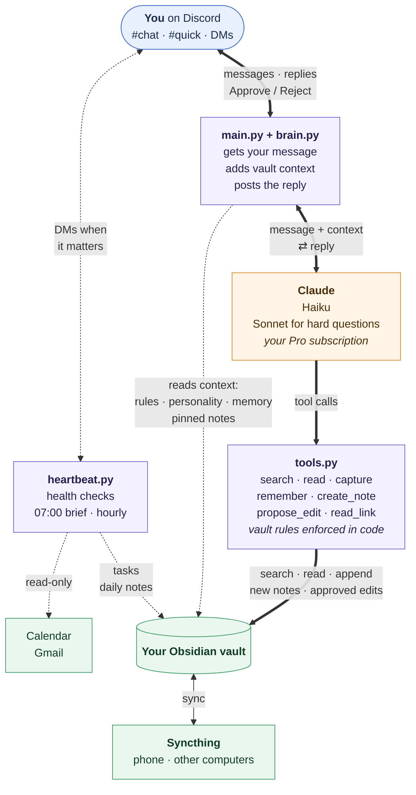

# Build your own AI assistant that lives on your computer

By [ianmllr](https://github.com/ianmllr)

Easy to modify to use a locally run LLM. Only the part that talks to Claude has to be swapped out, see [using a locally run LLM](docs/09-customise.md#using-a-locally-run-llm).

I wanted an assistant I could message from my phone that actually knows me, without handing my notes to yet another app. So I built one. It runs on an old laptop at home, keeps everything it learns in my Obsidian vault as plain Markdown, and talks to me through Discord. It doesn't need an API key: it uses the Claude Pro subscription I already pay for, through Claude Code and the Claude Agent SDK.

This repo has all the code, starter files for the vault, and a write-up of how to set it up. If you're fine in a Linux terminal, it's an evening's work.

## What it does

You write to it in a `#chat` channel and it answers in a thread. Every thread is its own conversation, and it remembers it, also after a restart. Before answering questions about you or your notes, it searches the vault and tells you which notes it used.

There's also a `#quick` channel for throwing things at it. Type "remind me to renew the domain on Friday" and it lands in today's daily note as a task with a date, tags and links to related notes, and you get one line back.

It learns as you talk to it. Things you tell it go into a memory file it reads every time, and if something belongs in a note you already have (like your laptop's specs in a devices note), it shows you the exact change with Approve and Reject buttons. Nothing changes until you click.

It can also start new notes. Ask it to help plan a birthday party and it writes the plan into a new note in the right folder, with tags, a checklist and a link to a related note. It won't overwrite a note that already exists.

Other things it does:

- reads images, so you can send it a screenshot or a photo of a spec sheet
- reads links you paste, like a Substack post you want summarised. It doesn't search the web, and after reading a page everything it wants to save in that conversation waits for your Approve
- answers with Haiku by default and passes hard questions on to Sonnet by itself (you can also start a message with `/sonnet` or `/opus`)
- sends you a morning brief at 07:00 and messages you during the day when something matters: an event coming up, a task that's due, an email that needs an answer. Calendar and mail are read-only (iCloud Calendar and Gmail)
- tells you when the computer itself has a problem, like sync stopping, the disk filling up or a power cut
- keeps an hourly history of the vault, so any note can be rolled back

The rules about what it may touch are enforced in the code, not only in the prompt. It can't read your `Private/` folder, can't delete or overwrite anything, and only writes where it's allowed to.

## How it fits together



`main.py` is a small Discord bot. For each message it collects some context from the vault (the rules, the assistant's personality, its memory, the notes you've pinned, today's daily note) and sends that plus your message to Claude via the Agent SDK. The SDK runs the Claude Code CLI under your own login, which is why a subscription is enough. Claude gets a handful of tools for searching, reading and writing the vault, and `tools.py` checks every one of those calls. Next to all this, `heartbeat.py` wakes up once a minute and decides whether there's anything worth telling you about.

[Chapter 5](docs/05-how-it-works.md) goes through it properly.

## What you need

- A Linux computer that can stay on. An old laptop is perfect, since it's quiet, uses little power and the battery covers short power cuts. I use Fedora; Ubuntu and Debian work the same way.
- Claude Pro or Max. Pro is plenty for one person.
- A Discord account and a server with just you in it.
- Obsidian and Syncthing, both free. Syncthing keeps the vault in sync between that computer, your phone and anything else.
- If you want the calendar and mail checks: an iCloud calendar and/or Gmail, with app-specific passwords.

It doesn't cost anything beyond the subscription, but every message counts towards your plan's usage limit. Most messages go to Haiku and only use a few thousand tokens. There was one nasty trap that made every message about 30 times bigger than it needed to be, it's in [chapter 8](docs/08-gotchas.md).

This uses your own Claude Code login, so it's meant for you alone. Don't let other people use your bot or run it as a service, and have a look at Anthropic's current terms for using a subscription with the Agent SDK.

## Setting it up

### The quick way: let Claude Code do it

Install Claude Code on the computer that will run the assistant and log in (`curl -fsSL https://claude.ai/install.sh | bash`, then run `claude`). Then give it something like this, with your details filled in:

```text
Build this for me on this computer: https://github.com/ianmllr/obsidian-memory-claude-assistant
Follow its README and the chapters in docs/ step by step.

- My name is <YOUR NAME>. Use it wherever the guide says "<your name>" or "the user".
- My Obsidian vault is at <PATH TO YOUR VAULT>. Ask me before you create, change or
  move anything in it.
- Never ask me to paste secrets (the Discord token, app passwords) into the chat.
  I'll put them in ~/agent/.env myself when you tell me to.
- Stop and tell me if something fails, instead of working around it.
```

It will clone the repo and install everything. You still have to do the bits it can't click for you: making the Discord bot, pasting the token into `.env`, creating app passwords and running the couple of commands that need `sudo`. At the end it goes through the tests from [chapter 4](docs/04-install.md) with you.

### Doing it yourself

```bash
git clone https://github.com/ianmllr/obsidian-memory-claude-assistant.git ~/assistant-guide
```

Then go through the chapters in order, starting with [chapter 1](docs/01-computer-and-sync.md). Each one ends with a short checklist.

1. [The computer and syncing](docs/01-computer-and-sync.md)
2. [The Discord bot](docs/02-discord-bot.md)
3. [The vault](docs/03-vault.md)
4. [Install and first run](docs/04-install.md)
5. [How it works](docs/05-how-it-works.md)
6. [The heartbeat](docs/06-heartbeat.md)
7. [Running it 24/7](docs/07-always-on.md)
8. [Things that went wrong](docs/08-gotchas.md)
9. [Making it yours](docs/09-customise.md)

## What's in the repo

```
assistant/            the program, copy this folder to ~/agent
  main.py               Discord: channels, threads, buttons, images, escalation, heartbeat loop
  brain.py              builds the context and calls Claude
  tools.py              the tools Claude can use, and the vault rules
  heartbeat.py          health checks, morning brief, hourly checks
  install.sh            sets everything up, safe to re-run
  always-on.sh          run once with sudo: no sleep, lid does nothing, battery care
  vault-snapshot.sh     hourly git history of the vault
  *.service, *.timer    systemd units
  .env.example          every setting, with comments
vault-templates/      starter files for your Obsidian vault
docs/                 the chapters
```

## Licence

[MIT](LICENSE). Use it, change it, share it.
