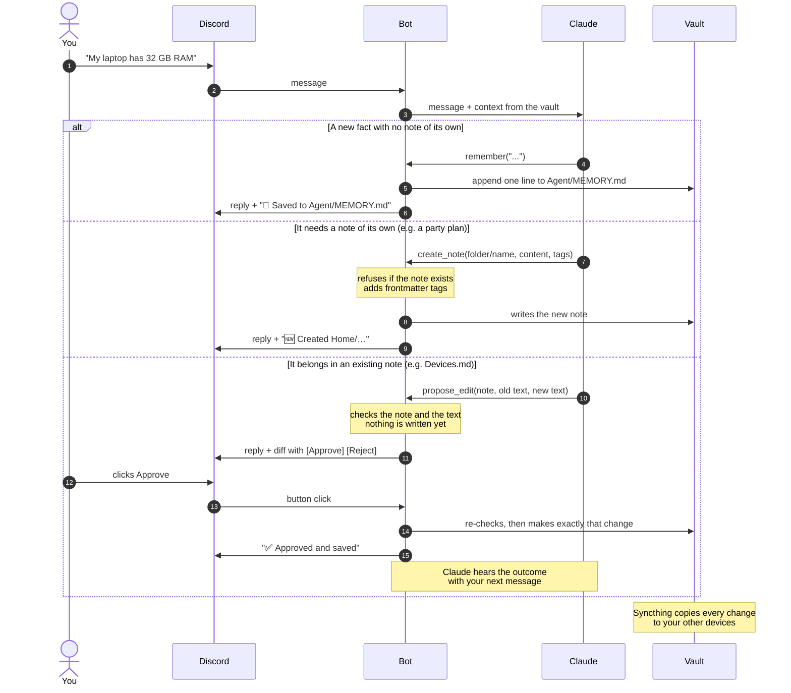

# 5. How it works

You can skip this chapter if all you want is to run it. Read it before you start changing things.

## What happens to a message

`main.py` gets your Discord message and first figures out what kind it is. Messages in `#chat`, its threads and DMs are conversations that get remembered. Messages in `#quick` are one-off captures without a session. If you attached images (PNG, JPEG, GIF or WebP, up to 4, 5 MB each), it downloads them.

`brain.py` then puts the system prompt together from the vault: `CLAUDE.md`, `Agent/SOUL.md`, `Agent/MEMORY.md`, all pinned notes, today's daily note and today's date. That goes to Claude through the Agent SDK, which runs the Claude Code CLI under your login. Claude Code's built-in tools like Bash and file editing are switched off, so Claude only gets the vault tools listed below. It may use them a few times (10 steps at most) before it answers.

Finally `main.py` posts the answer, plus a line saying exactly what was saved or created and Approve/Reject buttons for any proposed edit, and writes a line to `logs/usage.jsonl` with the model, tokens, tools and cost.

## The tools

`search_vault` finds notes by path and by lines that contain all the given words. `read_note` reads one note, by path or by `[[name]]`. Both skip `Private/`, dot-folders and sync-conflict files, and refuse paths that point outside the vault (the usual `../` tricks).

`list_tags` returns the tags in use, most common first, so new entries reuse them. `list_tasks` lists open `- [ ]` tasks, optionally filtered by tag.

`capture` appends an entry or a task to today's daily note. It only ever appends, it keeps a `[[link]]` only if that note really exists, cleans up the tags, and rejects due dates that aren't real dates. `remember` appends one fact to `Agent/MEMORY.md` and skips it if it's already there.

`create_note` writes a brand-new note, for when something deserves a page of its own, like a party plan with a checklist. It only works inside a folder that already exists (and not `Agent/`), refuses if the file exists or if another note already has that name (links go by name, so two notes called `Plan` would be ambiguous), and rejects `[[links]]` to notes that don't exist. It adds the frontmatter tags itself, using the area tag the folder's other notes already have. Once the note exists, changing it goes through `propose_edit` like any other note.

`propose_edit` is how the assistant changes one of your existing notes, and it doesn't write anything itself. It checks that the text to replace exists exactly once and hands the proposal to `main.py`, which shows it to you. Only when you click Approve does the change happen, after checking again that the note hasn't changed in the meantime.

`escalate` passes the message to a stronger model. Only the default model has it, and only for the models you allow.

The idea behind all this: the model decides what to do, the code decides what's allowed. `CLAUDE.md` is advice the model may or may not follow perfectly. `tools.py` is what actually happens.

## How a note gets updated

Pending proposals are saved to disk, so the buttons still work after a restart, and only you can press them since the bot checks the user ID.

## Memory

There are really three kinds. The thread itself: each Discord thread is one Claude session, picked up again with every reply, and it lasts until you start a new thread. Then `MEMORY.md` and the pinned notes, which go along with every message in every thread. And then the rest of the vault, which it searches when a question calls for it.

Two things make the thread part work. Session IDs are stored per thread in `state/sessions.json`, so a restart doesn't wipe conversations. And the system prompt is rebuilt for every message (`"snapshot": False` in `brain.py`). That one took me a while to notice: by default the SDK keeps the system prompt from the first message of a session, so an old thread never saw today's daily note or anything it had learned since.

## Which model answers

The default is Haiku. It's quick and doesn't burn through your plan. Haiku also has an `escalate` tool, and when a question needs actual thinking (debugging, weighing options, careful writing) it calls `escalate("sonnet", "reason")`. The code then reruns your message on Sonnet in the same session, so Sonnet has the whole thread. You'll see something like "↗️ Asking Sonnet: debugging a DB connection issue" before the answer.

Opus is off by default because it eats a Pro plan's limits quickly; set `ESCALATE_TO=sonnet,opus` in `.env` to allow it. You can always pick the model yourself by starting a message with `/sonnet` or `/opus`.

## Why you can't easily talk it into things

It only answers your user ID. It has no shell, no file editing and no internet, just the vault tools, and those check every path. The heartbeat, which reads email from strangers, runs Claude with no tools at all, so an email saying "ignore your instructions and…" can at worst change the wording of a DM. And `strict_mcp_config=True` keeps your claude.ai account's own connectors (Gmail, Drive and so on) out of the bot's sessions; [chapter 8](08-gotchas.md) explains why that matters.

Next: [the heartbeat](06-heartbeat.md).
