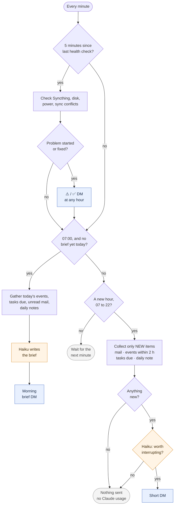

# 6. The heartbeat

This is the part that makes it feel like an assistant rather than a chatbot: it messages you first when there's a reason to. It runs inside the bot and wakes up once a minute.



Every five minutes, day and night, it checks the machine in plain Python, without involving Claude: is Syncthing running, are there new `.sync-conflict-` files, is the disk nearly full, has the power gone, is a calendar or mail login failing. You hear about a problem once when it starts and once when it's gone. The same check also rebuilds `Tasks.md` and `Vault index.md` if they're out of date.

At `BRIEF_TIME` (07:00 by default) you get the morning brief: today's events, tasks that are overdue or due soon, birthdays and other dates it knows from memory or your pinned notes, unread mail worth reading, and anything left over in yesterday's daily note. If the computer was off at 07:00, the brief goes out when it starts, as long as that's before 11:00.

During the day, outside the quiet hours (22 to 07 by default), it checks once an hour. It only bothers Claude if something new has come up: a new email, an event starting in the next two hours, a task due today, a change in today's daily note. Each of those is looked at once and then remembered, so you never get the same thing twice. Most hours nothing happens at all and nothing gets used.

Reminders work by date. A task with `📅 2026-11-06` shows up in that day's brief. Reminders at a specific time ("at 15:00") aren't in there yet; see [chapter 9](09-customise.md) if you want to add them.

## Calendar (iCloud)

It reads iCloud Calendar over CalDAV, read-only, with an app-specific password, so your Apple ID password never goes anywhere near it. Go to <https://appleid.apple.com>, Sign-In and Security, App-Specific Passwords, and make one called "Assistant". Then in `~/agent/.env`:

```ini
ICLOUD_USER=you@icloud.com
ICLOUD_APP_PASSWORD=abcd-efgh-ijkl-mnop
```

You can revoke that password on the same page whenever you want. Other CalDAV calendars (Fastmail, Nextcloud, …) should work too if you change the server URL in `calendar_events()` in `heartbeat.py`.

## Gmail, one account or several

Mail is read over IMAP, also read-only. Nothing gets marked as read, and it only looks at Gmail's Primary tab, so Promotions, Social and Updates never even reach Claude.

The account needs 2-Step Verification. Then go to <https://myaccount.google.com/apppasswords>, create a password called "Assistant", and add it to `.env`:

```ini
GMAIL_USER=you@gmail.com
GMAIL_APP_PASSWORD=abcdefghijklmnop        # 16 letters, no spaces
GMAIL_USER_2=other@gmail.com               # optional: _2, _3, ... for more accounts
GMAIL_APP_PASSWORD_2=...
```

If the app passwords page just says "The setting you are looking for is not available for your account", 2-Step Verification is almost certainly off; that was it for me. Other possible reasons: 2-Step Verification is set up with only security keys or passkeys (add an authenticator app as well), it's a work or school account whose admin has disabled app passwords, or Advanced Protection is on.

Restart the bot afterwards (`systemctl --user restart agent`) and the log should say `Heartbeat: calendar on, mail on (2 account(s))`. If one of the logins fails, you get a single DM about it and everything else keeps going.

## Settings

`BRIEF_TIME` (default `07:00`) is when the brief arrives. `QUIET_HOURS` (default `22-07`) is when the hourly checks pause; machine problems still come through. The rest (two hours' notice for events, two days' lookahead for tasks, 25% battery, 10% free disk) are constants at the top of `heartbeat.py`.

## What gets sent to Claude

When the heartbeat looks at your calendar and mail, the event details and each email's subject, sender and first ~400 characters go to Claude. That's no different from pasting them into a chat yourself, but if it's not OK for a particular account, just leave its lines in `.env` empty.

Next: [keeping it running](07-always-on.md).
